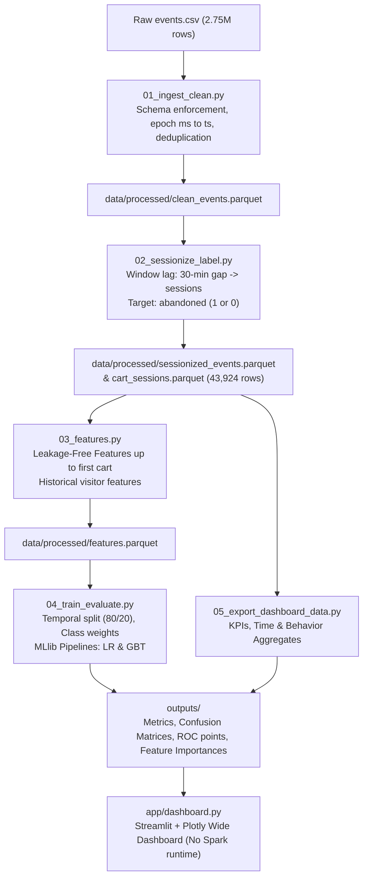

# 🎓 Viva & Interview Master Guide: Predicting Online Shopping Cart Abandonment

This comprehensive guide is designed to prepare you thoroughly for your project viva, oral examination, and technical presentations. It explains everything from fundamental concepts, dataset details, mathematical metrics, PySpark architecture, step-by-step code design, model evaluation, and anticipated viva Q&As.

---

## 📑 Table of Contents
1. [Project Elevator Pitch (30-Second Summary)](#1-project-elevator-pitch-30-second-summary)
2. [Business & Real-World Context](#2-business--real-world-context)
3. [The Dataset: Retailrocket Deep Dive](#3-the-dataset-retailrocket-deep-dive)
4. [Why Big Data & Why PySpark?](#4-why-big-data--why-pyspark)
5. [End-to-End Pipeline Architecture](#5-end-to-end-pipeline-architecture)
6. [Step-by-Step Technical Breakdown](#6-step-by-step-technical-breakdown)
   - [Step 1: Data Ingestion & Cleaning (`01_ingest_clean.py`)](#step-1-data-ingestion--cleaning-01_ingest_cleanpy)
   - [Step 2: Sessionization & Target Labeling (`02_sessionize_label.py`)](#step-2-sessionization--target-labeling-02_sessionize_labelpy)
   - [Step 3: Leakage-Free Feature Engineering (`03_features.py`)](#step-3-leakage-free-feature-engineering-03_featurespy)
   - [Step 4: MLlib Modeling & Class Weighting (`04_train_evaluate.py`)](#step-4-mllib-modeling--class-weighting-04_train_evaluatepy)
   - [Step 5: Decoupled Dashboard Export (`05_export_dashboard_data.py`)](#step-5-decoupled-dashboard-export-05_export_dashboard_datapy)
   - [Step 6: Interactive Web UI (`app/dashboard.py`)](#step-6-interactive-web-ui-appdashboardpy)
7. [Mathematical Metrics Explained Simply](#7-mathematical-metrics-explained-simply)
8. [Final Project Results & Key Takeaways](#8-final-project-results--key-takeaways)
9. [Comprehensive Viva Questions & Model Answers (Top 30)](#9-comprehensive-viva-questions--model-answers-top-30)

---

## 1. Project Elevator Pitch (30-Second Summary)
> *"In e-commerce, over 70% of shoppers add products to their carts but leave without purchasing, resulting in trillions in lost revenue. In this project, we built an enterprise-grade Big Data pipeline using **PySpark** and the **Retailrocket dataset (2.75 million user events)** to predict online shopping cart abandonment in real-time. By sessionizing raw clickstream data with a 30-minute inactivity threshold, we formulated a strict, leakage-free prediction point at the visitor's first `addtocart` action. Using time-based temporal splitting, inverse class weighting, and Spark MLlib pipelines, our Gradient-Boosted Tree model achieved an **AUC-ROC of 0.6791** and an **AUC-PR of 0.8386**, demonstrating that user engagement velocity and historical purchase behavior are the primary predictors of conversion."*

---

## 2. Business & Real-World Context

### What is Shopping Cart Abandonment?
Cart abandonment occurs when a prospective customer starts the checkout process for an online order by adding an item to the shopping cart, but drops out before completing the transaction.

### Why is it a Critical Problem?
1. **Lost Revenue**: Baymard Institute estimates the global average e-commerce cart abandonment rate at roughly 70%.
2. **Wasted Customer Acquisition Cost (CAC)**: E-commerce companies spend heavy marketing budgets (Google Ads, Facebook campaigns) to bring visitors to the site. If they leave after adding to cart, that ad spend produces zero return.
3. **Actionable Intervention Opportunity**: If a machine learning model can predict abandonment **at the exact second the user adds an item to cart**, the retailer can dynamically trigger interventions:
   - Showing a limited-time 5% checkout discount or free shipping coupon.
   - Triggering an exit-intent popup.
   - Sending an automated follow-up notification or email within 15 minutes.

---

## 3. The Dataset: Retailrocket Deep Dive

### What is Retailrocket?
Retailrocket is an e-commerce personalization company. They released a real-world, anonymized clickstream dataset collected over 4.5 months (May 3, 2015 to September 18, 2015).

### What Raw File Do We Use?
We use strictly `data/raw/events.csv` (~94 MB, **2,756,101 rows**).
*(Note: Retailrocket also provides `category_tree.csv` and `item_properties.csv`, but to keep the scope tight and focused on clickstream behavior, our project focuses solely on `events.csv`)*.

### Schema of `events.csv`:
| Column Name | Data Type (Raw) | Description | Example |
| :--- | :--- | :--- | :--- |
| `timestamp` | Long (int64) | Unix epoch time in **milliseconds** | `1433221332117` |
| `visitorid` | Long (int64) | Unique anonymized ID for the visitor | `257597` |
| `event` | String | Event type: only 3 possible values: `view`, `addtocart`, `transaction` | `view` |
| `itemid` | Long (int64) | Unique ID of the product viewed/carted/bought | `355908` |
| `transactionid` | String / Null | Unique ID of transaction (populated **only** if event is `transaction`) | `12345` or `NULL` |

### Natural Conversion Funnel (Extreme Skew):
In the raw cleaned dataset:
- `view`: **2,664,218** events (~96.7%)
- `addtocart`: **68,966** events (~2.5%)
- `transaction`: **22,457** events (~0.8%)

*Viva Tip*: Be ready to mention that clickstream data has an extreme funnel drop-off: most actions are passive views, only ~2.5% add to cart, and under 1% transact.

---

## 4. Why Big Data & Why PySpark?

### Why Not Just Use Plain Python / Pandas?
- **Scalability**: Pandas loads entire datasets into a single machine's RAM. While a 94 MB CSV fits in RAM, real e-commerce systems process **hundreds of gigabytes or terabytes** of clickstream events every single day.
- **Distributed Computing**: Apache Spark distributes data across partitions and cores (or multiple cluster nodes), computing transformations in parallel.
- **Fault Tolerance**: Spark's Resilient Distributed Datasets (RDD) and Catalyst Optimizer handle execution graphs (DAGs), optimizing query plans and retrying failed worker tasks automatically.
- **Enterprise ML (MLlib)**: MLlib provides distributed machine learning algorithms designed to train across millions of rows without memory bottlenecks.

### PySpark Configuration Used in This Project:
- **`master("local[*]")`**: Uses all available CPU cores on your machine.
- **`spark.driver.memory = "4g"`**: Allocates 4 GB of RAM to the Spark Driver to prevent out-of-memory errors.
- **`spark.sql.shuffle.partitions = 8`**: Optimizes the number of partitions created during shuffles (joins, windowing, groupBy) for local multi-core CPUs.
- **Storage Format**: **Parquet** (columnar storage format with snappy compression, drastically faster to read and query than CSV).

---

## 5. End-to-End Pipeline Architecture



---

## 6. Step-by-Step Technical Breakdown

### Step 1: Data Ingestion & Cleaning (`01_ingest_clean.py`)
- **Explicit Schema**: Instead of letting Spark infer schema (which requires an extra full-table pass and can infer wrong types), we explicitly provide a `StructType`:
  ```python
  StructType([
      StructField("timestamp", LongType(), False),
      StructField("visitorid", LongType(), False),
      StructField("event", StringType(), False),
      StructField("itemid", LongType(), False),
      StructField("transactionid", StringType(), True),  # nullable
  ])
  ```
- **Epoch Conversion**: Raw timestamps are in milliseconds (`1433221332117`). We convert them to standard Spark `TimestampType`:
  $$\text{timestamp} = \text{to\_timestamp}(\text{col} / 1000.0)$$
- **Null Filtering**: Drop records where `visitorid`, `timestamp`, `event`, or `itemid` are null. Notice that `transactionid` is intentionally kept nullable because views and cart additions do not have transaction IDs.
- **Deduplication**: Drops redundant rows that have identical visitor, timestamp, event, and item.
- **Fast Development Support**: Includes a `--sample FLOAT` argument (e.g. `--sample 0.1` samples 10% of unique visitors) to allow testing code changes in seconds before running the full dataset.

---

### Step 2: Sessionization & Target Labeling (`02_sessionize_label.py`)

#### How are Sessions Built? (The 30-Minute Inactivity Rule)
Web analytics tools like Google Analytics define a "session" as a continuous period of user activity that ends after 30 minutes of inactivity.
We implement this in PySpark using **Window Functions**:
1. Partition events by `visitorid`, sorted by `timestamp ASC`.
2. Compute `prev_ts = lag(timestamp, 1)` over the visitor window.
3. If `timestamp - prev_ts > 1800` seconds (or if `prev_ts` is null, i.e., visitor's very first event), flag `is_new_session = 1`, otherwise `0`.
4. Run a cumulative sum: `sum(is_new_session).over(unboundedPreceding to currentRow)` to generate `visitor_session_num` (0, 1, 2...).
5. Form unique `session_id = concat(visitorid, "_", visitor_session_num)`.

#### How is the Target Label Defined?
- We filter for **Cart Sessions**: sessions containing at least one `addtocart` event (Total: **43,924 sessions**).
- **Prediction Point**: The timestamp of the visitor's **first `addtocart`** in that session (`first_cart_ts`).
- **Target (`abandoned`)**:
  - `abandoned = 1`: If the session has **no** `transaction` at or after `first_cart_ts`.
  - `abandoned = 0` (Converted): If a `transaction` occurs at or after `first_cart_ts`.
- **Resulting Class Distribution**:
  - Abandoned: **32,164** (73.23%)
  - Converted: **11,760** (26.77%)

---

### Step 3: Leakage-Free Feature Engineering (`03_features.py`)

#### ⚠️ What is Data Leakage and Why is it Fatal?
Data leakage happens when information from the future (or information that directly reveals the label) is accidentally included in model training. If a model is trained with leaked data, it achieves 99% accuracy in tests but completely fails when deployed in production.

#### How Our Features Strictly Prevent Leakage:
1. **Intra-Session Features**: Computed **strictly using events where `timestamp <= first_cart_ts`**. We never look at events that happened after the first cart addition!
   - `views_before_cart`: Number of product views before/at the first cart addition.
   - `distinct_items_viewed`: Number of distinct items explored before carting (measures comparison shopping).
   - `seconds_to_cart`: Elapsed time from session start to first cart addition (measures purchase velocity).
   - `hour_of_day`: Hour (0-23) when the cart action occurred.
   - `day_of_week`: Day of week (1=Sunday ... 7=Saturday).
2. **Historical Visitor Features**: Computed using **prior sessions only** (`session_start_time < current_session_start_time`).
   - `prior_sessions`: Number of past browsing sessions by this visitor.
   - `prior_purchases`: Number of past transactions completed in earlier sessions by this visitor.

---

### Step 4: MLlib Modeling & Class Weighting (`04_train_evaluate.py`)

#### 1. Temporal Split (Not Random Split!)
- **Why?** Standard random splits (`randomSplit([0.8, 0.2])`) cause temporal data leakage by training on future sessions and testing on past sessions.
- **Our Solution**: We compute the 80th percentile timestamp of `first_cart_ts`. The earliest ~80% of sessions (May to mid-August, 35,136 sessions) form the **Training Set**; the latest ~20% of sessions (mid-August to mid-September, 8,788 sessions) form the **Test Set**. This mirrors real-world deployment.

#### 2. Class Weighting for Imbalance
- The dataset is imbalanced: ~73% abandoned vs ~27% converted.
- An unweighted classifier might lazily guess "abandoned" for every case and achieve 73% accuracy while learning nothing.
- We compute inverse frequency weights:
  $$\text{weight}_k = \frac{N_{\text{total}}}{2 \times N_k}$$
  - Class 0 (Converted): weight = **1.8628**
  - Class 1 (Abandoned): weight = **0.6834**
- Passed directly to PySpark models via `weightCol="class_weight"`.

#### 3. Models Trained:
1. **Logistic Regression (Baseline)**: Linear probabilistic classification with L2 regularization. Fast, highly interpretable.
2. **GBTClassifier (Gradient-Boosted Trees)**: Ensemble of sequential decision trees where each tree corrects the residual errors of preceding trees. Non-linear, captures complex feature interactions.

#### 4. VectorAssembler & Pipeline:
All 7 feature columns are assembled into a single Spark ML `DenseVector` via `VectorAssembler`. The assembler and classifier are bundled in a Spark `Pipeline` to ensure reproducible training and transformation.

---

### Step 5: Decoupled Dashboard Export (`05_export_dashboard_data.py`)
- Running a live PySpark session inside a web server is slow, memory-intensive, and prone to crashes.
- This script pre-aggregates all heavy Spark DataFrames into lightweight summary files in `outputs/`:
  - `kpis.json`: High-level session counts, conversion, dates.
  - `abandonment_by_hour.csv` & `abandonment_by_weekday.csv`: Diurnal/weekly patterns.
  - `behavior_views.csv` & `behavior_time.csv`: Pre-cart browsing distributions.
  - `model_metrics.csv`, `confusion_matrices.csv`, `feature_importances.csv`, `roc_curve.csv`.

---

### Step 6: Interactive Web UI (`app/dashboard.py`)
Built with **Streamlit** and **Plotly** with a wide layout and three dedicated tabs:
1. **📊 Overview**: KPI stat cards (`st.metric`) and temporal line/bar charts.
2. **🔍 User Behavior**: Visualizing how the number of product views and time-to-cart affect abandonment probability.
3. **🤖 Model Performance**: Side-by-side metric table, interactive ROC curve, confusion matrix heatmaps, and horizontal GBT feature importance chart.
- Uses `@st.cache_data` for instant page loads with **zero PySpark dependency**.

---

## 7. Mathematical Metrics Explained Simply

In an oral exam, professors love to ask you to define these metrics from scratch:

### Confusion Matrix Terminology (Positive Class = Abandoned = 1):
- **True Positive (TP)**: Actually abandoned, model predicted abandoned.
- **False Positive (FP)**: Actually converted, model predicted abandoned (Type I Error).
- **False Negative (FN)**: Actually abandoned, model predicted converted (Type II Error).
- **True Negative (TN)**: Actually converted, model predicted converted.

### Key Formulas:

1. **Precision**: Out of all sessions the model predicted as abandoned, how many were truly abandoned?
   $$\text{Precision} = \frac{\text{TP}}{\text{TP} + \text{FP}}$$

2. **Recall (Sensitivity)**: Out of all truly abandoned sessions, how many did the model successfully identify?
   $$\text{Recall} = \frac{\text{TP}}{\text{TP} + \text{FN}}$$

3. **F1-Score**: Harmonic mean of Precision and Recall (balances both):
   $$\text{F1} = 2 \times \frac{\text{Precision} \times \text{Recall}}{\text{Precision} + \text{Recall}}$$

4. **AUC-ROC (Area Under Receiver Operating Characteristic Curve)**:
   - Plots True Positive Rate (Recall) vs False Positive Rate ($\text{FPR} = \frac{\text{FP}}{\text{FP} + \text{TN}}$) across all possible decision thresholds (0.0 to 1.0).
   - **Interpretation**: A score of **0.50** is random guessing; **1.0** is a perfect classifier. Our GBT scored **0.6791**.

5. **AUC-PR (Area Under Precision-Recall Curve)**:
   - Plots Precision vs Recall across all decision thresholds.
   - **Crucial for imbalanced data**: When the positive class is dominant or of high interest, AUC-PR is far more informative than AUC-ROC because it does not get inflated by large numbers of true negatives. Our GBT scored **0.8386**.

---

## 8. Final Project Results & Key Takeaways

### Full Dataset Model Evaluation (Test Set: 8,788 Sessions)

| Metric | Logistic Regression | GBTClassifier | Better Model |
| :--- | :---: | :---: | :---: |
| **AUC-ROC** | 0.6365 | **0.6791** | **GBT** (+4.26%) |
| **AUC-PR** | 0.7945 | **0.8386** | **GBT** (+4.41%) |
| **Precision (Weighted)** | 0.6997 | 0.6990 | ~Tie |
| **Recall (Weighted)** | **0.7251** | 0.6798 | LR (Aggressive recall) |
| **F1-Score (Weighted)** | **0.7071** | 0.6878 | LR |
| **Abandoned Precision (Class 1)**| 0.7814 | **0.8024** | **GBT** |
| **Abandoned Recall (Class 1)** | **0.8690** | 0.7487 | LR |
| **Abandoned F1 (Class 1)** | **0.8229** | 0.7746 | LR |

### Confusion Matrix Breakdown (Test Set):
- **Logistic Regression**: TP = 5,613 | FP = 1,570 | FN = 846 | TN = 759
- **GBTClassifier**: TP = 4,836 | FP = 1,191 | FN = 1,623 | TN = 1,138

### Top Feature Importances (From GBT):
1. **`prior_purchases` (30.13%)**: The single strongest predictor. Visitors who have previously bought from the store have established trust and are vastly more likely to buy again.
2. **`hour_of_day` (18.70%)**: Shopping intent varies wildly by time of day (late-night browsing vs. active daytime purchasing).
3. **`seconds_to_cart` (12.62%)**: Fast cart additions indicate high intent or search-driven shoppers; very long sessions before carting indicate hesitation.
4. **`day_of_week` (11.14%)**: Differences between weekday shopping (desktop/work hours) and weekend leisure browsing.
5. **`prior_sessions` (11.00%)**: Frequent visitors without purchases indicate chronic comparison shoppers.
6. **`views_before_cart` (9.65%)** & **`distinct_items_viewed` (6.77%)**: Breadth of product research.

---

## 9. Comprehensive Viva Questions & Model Answers (Top 30)

### Section A: Dataset & Problem Formulation
**Q1: What is the primary objective of your project?**
> *Answer*: To predict whether an e-commerce browsing session will abandon its shopping cart at the earliest decision point (the first `addtocart` action) using PySpark and MLlib on the Retailrocket dataset.

**Q2: What is Retailrocket dataset and what does it contain?**
> *Answer*: It is an anonymized real-world e-commerce clickstream dataset containing over 2.75 million events collected over 4.5 months in 2015. Each record has a timestamp (in ms), a visitor ID, an event type (`view`, `addtocart`, or `transaction`), an item ID, and an optional transaction ID.

**Q3: Why did you not use `category_tree.csv` or `item_properties.csv`?**
> *Answer*: We maintained a tight project scope focused on real-time clickstream behavioral dynamics. Item properties files are heavily masked and lack price and brand metadata, whereas user behavioral velocity provides the clearest real-time signal for immediate cart intervention.

**Q4: How did you define a "session"? Why 30 minutes?**
> *Answer*: A session is a sequence of interactions by a single visitor where no consecutive actions are separated by more than 30 minutes of inactivity. The 30-minute inactivity rule is the standard e-commerce convention established by Google Analytics and industry benchmarks.

**Q5: Exactly what is the prediction point in your pipeline?**
> *Answer*: The prediction point is the timestamp of the visitor's **first `addtocart` event** in that session. We only classify sessions that reach a cart action, and we trigger prediction the moment the first item is added.

**Q6: What is the definition of the target label `abandoned`?**
> *Answer*: In a cart session, `abandoned = 1` if no `transaction` event occurs at or after the first `addtocart` timestamp. If a `transaction` event occurs at or after that timestamp, `abandoned = 0` (converted).

---

### Section B: Data Leakage & Feature Engineering
**Q7: What is data leakage and how did you prevent it?**
> *Answer*: Data leakage occurs when future or label-revealing information enters training data. We prevented it in three strict ways:
> 1. Intra-session features only consider events timestamped $\le \text{first\_cart\_ts}$.
> 2. Historical features only aggregate earlier sessions ($\text{session\_start\_time} < \text{current\_session\_start\_time}$).
> 3. We used a chronological/time-based train/test split rather than a random split.

**Q8: What features did you engineer?**
> *Answer*: Seven features across three categories:
> - *Pre-cart behavioral*: `views_before_cart`, `distinct_items_viewed`, `seconds_to_cart`.
> - *Temporal context*: `hour_of_day`, `day_of_week`.
> - *Visitor history*: `prior_sessions`, `prior_purchases`.

**Q9: Why is `seconds_to_cart` important?**
> *Answer*: It measures the elapsed time from session start to first cart addition. Users who add an item within 60 seconds often know exactly what they want (high buying intent), whereas users taking 20+ minutes may be hesitating or casually browsing.

---

### Section C: PySpark & Big Data Mechanics
**Q10: Why did you choose PySpark instead of Pandas and Scikit-Learn?**
> *Answer*: In production e-commerce, clickstream logs span hundreds of millions of events and hundreds of gigabytes, exceeding single-machine RAM. PySpark distributes computation across worker cores, optimizes query execution with the Catalyst Optimizer, and scales seamlessly from a laptop to multi-node cloud clusters.

**Q11: Explain how you implemented sessionization in PySpark.**
> *Answer*: We used window functions:
> 1. Window partitioned by `visitorid` ordered by `timestamp ASC`.
> 2. Applied `lag(timestamp, 1)` to find the gap between successive events.
> 3. Flagged `is_new_session = 1` if `gap > 1800` seconds or `prev_ts` was null.
> 4. Computed a cumulative sum over `unboundedPreceding` to `currentRow` to assign monotonic session indices.

**Q12: What does `spark.sql.shuffle.partitions = 8` do?**
> *Answer*: By default, Spark sets shuffle partitions to 200, which creates unnecessary overhead and empty tasks for local multi-core machines. Setting it to 8 matches our available hardware threads, significantly reducing serialization and scheduling overhead.

**Q13: Why did you use Parquet instead of CSV for intermediate storage?**
> *Answer*: Parquet is a binary, columnar storage format with snappy compression. It stores schemas and column statistics, supports predicate pushdown, and is up to 10x faster to read while using significantly less disk space than CSV.

---

### Section D: Modeling, Class Imbalance & Evaluation
**Q14: What was the class distribution, and how did you address imbalance?**
> *Answer*: 73.23% of cart sessions were abandoned and 26.77% converted (roughly a 2.7:1 ratio). We handled this by computing inverse class frequency weights: $\text{weight} = \frac{N_{\text{total}}}{2 \times N_k}$ ($1.8628$ for converted, $0.6834$ for abandoned) and passing them to PySpark's `weightCol`.

**Q15: Why didn't you use SMOTE or random oversampling?**
> *Answer*: SMOTE creates synthetic points in continuous feature space, which can distort real-world clickstream distributions and discrete counts (like prior purchases). Inverse class weighting accomplishes balanced cost-sensitivity inside the loss function without distorting the underlying data distribution.

**Q16: Why did you choose Logistic Regression and GBT?**
> *Answer*: Logistic Regression serves as a fast, interpretable, linear probabilistic baseline. GBTClassifier is an ensemble of decision trees that excels at capturing complex non-linear interactions, skewed distributions, and threshold effects without requiring feature normalization.

**Q17: Why did you use a temporal train/test split instead of `randomSplit`?**
> *Answer*: In e-commerce, models predict future user sessions based on past sessions. A random split introduces lookahead bias by training on September data to predict May data. Our time-based split trained on the earliest 80% of sessions and tested on the latest 20%.

**Q18: Why is accuracy a misleading metric here?**
> *Answer*: Since 73% of cart sessions are abandoned, a naive classifier that simply outputs "abandoned" for every row would achieve 73% accuracy while having zero ability to identify converting users. AUC-ROC, AUC-PR, Precision, Recall, and F1 provide an honest assessment across both classes.

**Q19: What is the difference between AUC-ROC and AUC-PR? Which is more informative?**
> *Answer*: AUC-ROC measures trade-offs between True Positive Rate and False Positive Rate across thresholds; it can be overly optimistic when negatives are frequent. AUC-PR evaluates Precision vs. Recall directly on the positive class without being influenced by True Negatives, making it a more stringent and informative metric under class imbalance.

**Q20: What were the final results of your models?**
> *Answer*: GBTClassifier outperformed Logistic Regression:
> - **GBT**: AUC-ROC = **0.6791**, AUC-PR = **0.8386**, Abandoned Precision = **80.24%**.
> - **LR**: AUC-ROC = 0.6365, AUC-PR = 0.7945, Abandoned Precision = 78.14%.

**Q21: What was the most important feature according to the GBT model?**
> *Answer*: `prior_purchases` (accounting for ~30.1% of feature importance), followed by `hour_of_day` (~18.7%) and `seconds_to_cart` (~12.6%).

---

### Section E: Software Engineering, Architecture & Dashboard
**Q22: Why does your Streamlit dashboard NOT import or run PySpark?**
> *Answer*: Running Spark inside a lightweight interactive web server introduces heavy startup latency (JVM init), consumes 4+ GB of RAM, and can freeze the UI. Decoupling the pipeline allows Spark to execute in batch, exporting compact CSV/JSON summaries to `outputs/`, which Streamlit reads instantly using Pandas and `@st.cache_data`.

**Q23: How does your code support fast development testing?**
> *Answer*: Every script accepts a `--sample FLOAT` CLI argument (e.g., `--sample 0.1` samples 10% of unique visitors). This allows developers to test pipeline logic and verify end-to-end functionality in seconds before launching full-scale runs.

**Q24: What are the main limitations of this project?**
> *Answer*:
> 1. *No price or shipping data*: Unexpected shipping cost is the #1 real-world reason for cart abandonment, but it is absent from Retailrocket.
> 2. *Fixed 30-minute session boundary*: Does not account for users who keep mobile tabs open and return hours later.
> 3. *Single prediction point*: Only predicts at the *first* cart addition, without updating predictions if additional items are carted later.

**Q25: If you deployed this in production, how would it work in real time?**
> *Answer*: Clickstream events would stream into Apache Kafka, processed via Spark Structured Streaming. The moment an `addtocart` event arrives for a session, the feature vector would be assembled and scored by the trained model pipeline in milliseconds, returning an abandonment probability to trigger targeted on-site interventions.

---

### Summary Checklist for Viva Day
- [x] Know the exact number of events (**2.75M**) and cart sessions (**43,924**).
- [x] Know the abandonment rate (**73.23%**).
- [x] State the prediction point (**first `addtocart`**).
- [x] Explain the 30-minute window logic clearly.
- [x] Explain why random split causes data leakage.
- [x] State the winning model (**GBTClassifier with 0.6791 AUC-ROC / 0.8386 AUC-PR**).
- [x] Name the top feature (**`prior_purchases` at 30.1%**).

